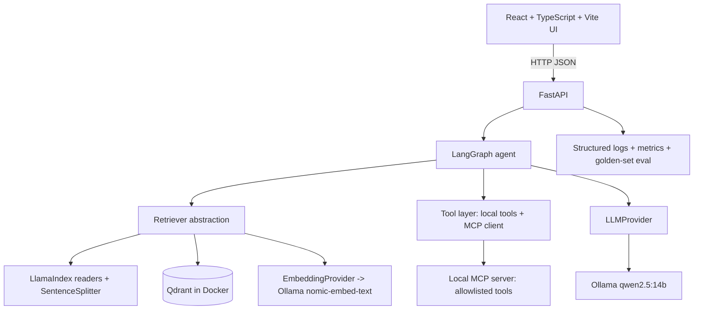
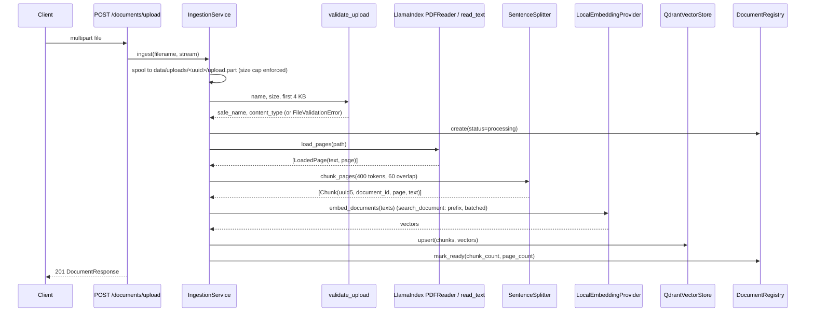
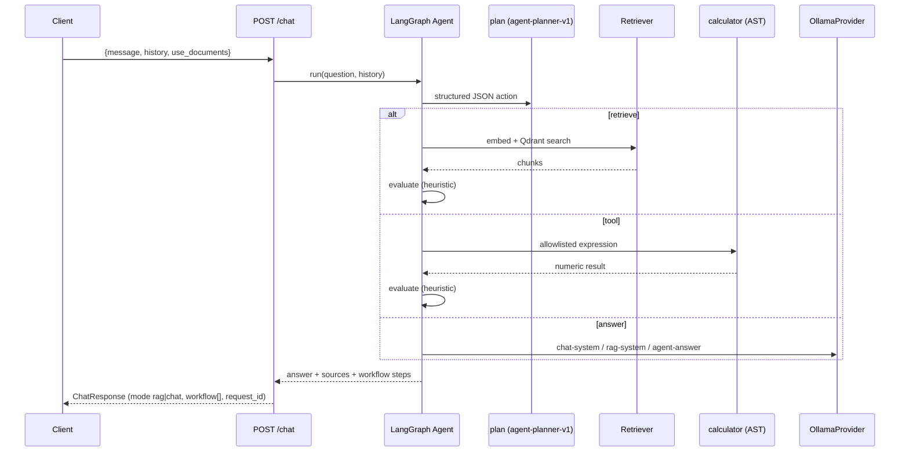
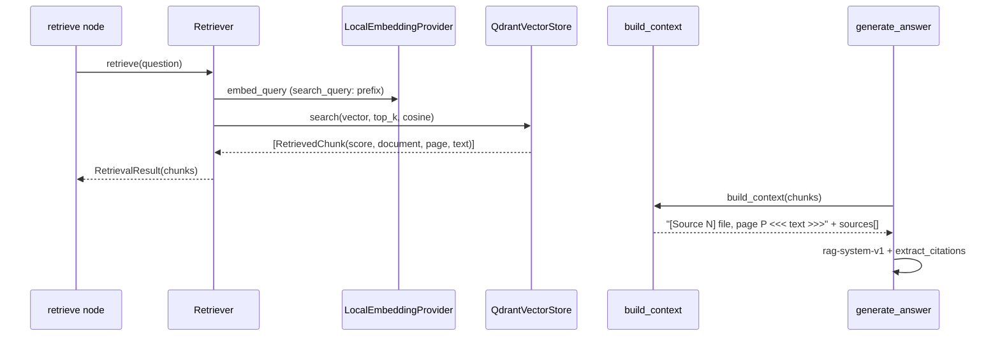
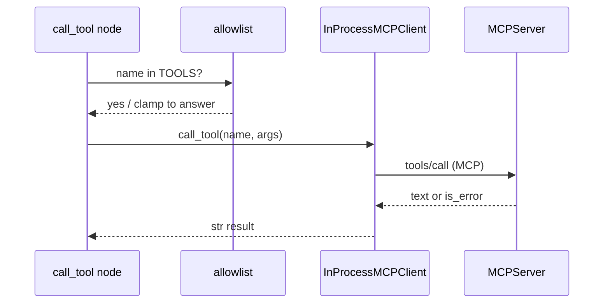
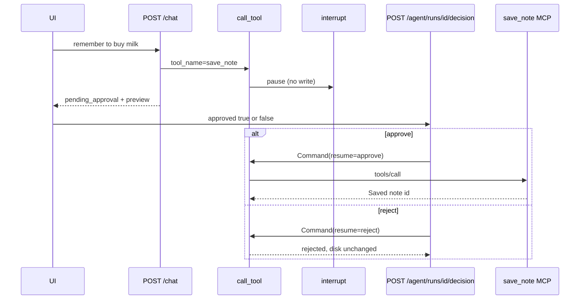
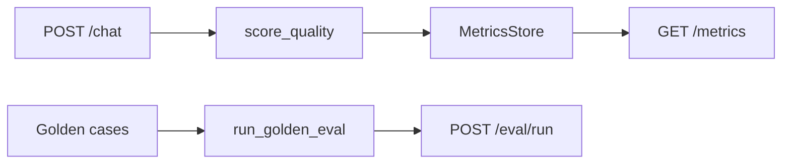

# Architecture

This document captures the target design and is updated as phases land. Sections marked
*(planned)* describe components not yet implemented (Phase 8: Docker Compose + CI).

## Component map

## Responsibilities

| Component | Responsibility | Status |
| --- | --- | --- |
| FastAPI | HTTP boundary, validation, error handling, request IDs | Phase 1 |
| `LLMProvider` / `OllamaProvider` | Vendor-neutral chat completion and health check | Phase 1 |
| Prompt registry | Versioned system prompts, version logged per request | Phase 1 |
| Observability | JSON logs with request correlation; in-process metrics | Phase 1 (logs), Phase 7 (metrics) |
| Upload security | Allowlist + content sniffing, safe filenames, streaming size cap | Phase 2 |
| LlamaIndex | `PDFReader` per-page loading, `SentenceSplitter` overlapping chunks | Phase 2 |
| `EmbeddingProvider` / `LocalEmbeddingProvider` | Local embeddings via Ollama `nomic-embed-text` | Phase 2 |
| `VectorStore` / `QdrantVectorStore` | Points: chunk UUID, vector, payload (document, page, text, metadata) | Phase 2 |
| `DocumentRegistry` | SQLite table of documents with status and counts | Phase 2 |
| `Retriever` + `RAGPipeline` | Embed question, search, build cited context, answer with sources | Phase 2 |
| React UI | Sidebar (upload/status/delete), chat, source citations, activity placeholder | Phase 3 |
| CORS | Allowlisted Vite origin; `X-Request-ID` exposed to the browser | Phase 3 |
| LangGraph | Stateful plan / retrieve / tool / evaluate loop with conditional routing | Phase 4 |
| Trace store | In-memory high-level steps keyed by request ID (no content) | Phase 4 |
| MCP server + client | Allowlisted calculator + clock over official `mcp` SDK | Phase 5 |
| Human-in-the-loop | `interrupt()` on `save_note`; `POST /agent/runs/{id}/decision` | Phase 6 |
| Evaluation | Golden set, citation rate, lexical groundedness, HITL checks | Phase 7 |
| Docker Compose + CI | `frontend`, `backend`, `qdrant`; GitHub Actions lint/test/build | Phase 8 *(planned)* |

## Ingestion flow (Phase 2)

## Question flow (Phase 4)

`use_documents=false` clamps any `retrieve` decision to `answer`. Unknown tool names are
also clamped. The inspectable trace (`GET /agent/trace/{request_id}`) stores node names and
step labels only.

## Question flow (Phase 2, always-retrieve RAG — still used inside the retrieve node)

## Agent graph (Phase 4)

State carried through the graph: `question`, `history`, `steps[]` (high-level trace shown
to the user), `chunks[]`, `tool_results[]`, `step_count`, `answer`, `sources`.
`save_note` calls `interrupt()`; `ChatResponse.pending_approval` carries the proposal.

## Tool calls (Phase 5)

Default transport is in-process (`Client(server)`). `python -m app.mcp` serves the same
tools over stdio.

## Human approval (Phase 6)

## Guiding simplifications

- LlamaIndex is used for ingestion only; embedding, upsert and search are explicit in our
  code so each step can be explained and tested.
- LangChain is used for interfaces (`ChatOllama`, `@tool`, prompts, structured output),
  never for opaque chains or agent executors.
- One LLM call per graph step and a hard step budget keep the agent inspectable.
- No external databases beyond Qdrant; the document registry is SQLite.

## LLMOps (Phase 7)

Online: every finished (or paused) agent run records latency, tokens, tools, citation
rate and groundedness — never the answer text. Offline: the same graph runs against
fakes on a pinned dataset (`python -m app.eval`). Retrieval hit and generation quality
are separate checks.

