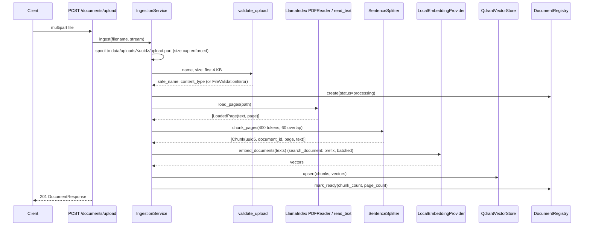
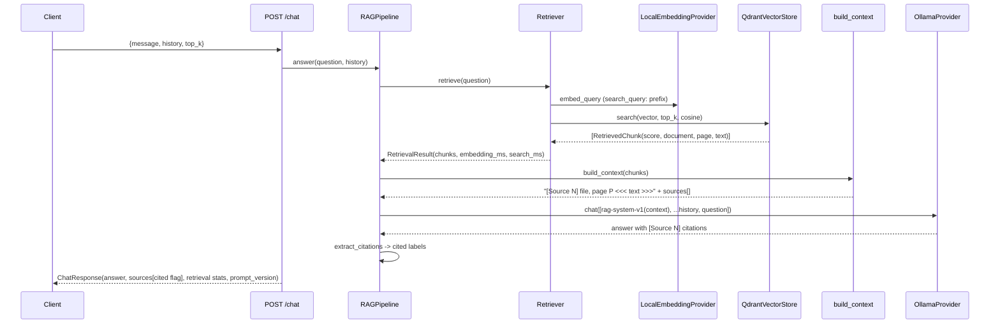
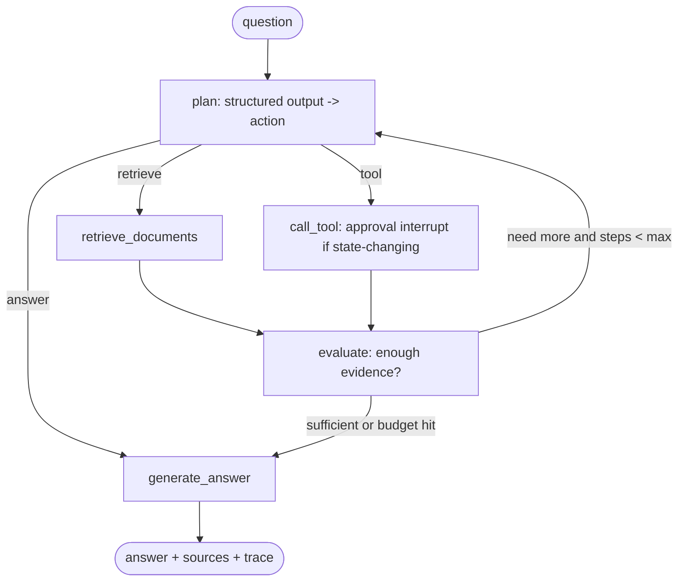

# Architecture

This document captures the target design and is updated as phases land. Sections marked
*(planned)* describe components not yet implemented.

## Component map

## Responsibilities

| Component | Responsibility | Status |
| --- | --- | --- |
| FastAPI | HTTP boundary, validation, error handling, request IDs | Phase 1 |
| `LLMProvider` / `OllamaProvider` | Vendor-neutral chat completion and health check | Phase 1 |
| Prompt registry | Versioned system prompts, version logged per request | Phase 1 |
| Observability | JSON logs with request correlation; metrics and traces later | Phase 1 (base) |
| Upload security | Allowlist + content sniffing, safe filenames, streaming size cap | Phase 2 |
| LlamaIndex | `PDFReader` per-page loading, `SentenceSplitter` overlapping chunks | Phase 2 |
| `EmbeddingProvider` / `LocalEmbeddingProvider` | Local embeddings via Ollama `nomic-embed-text` | Phase 2 |
| `VectorStore` / `QdrantVectorStore` | Points: chunk UUID, vector, payload (document, page, text, metadata) | Phase 2 |
| `DocumentRegistry` | SQLite table of documents with status and counts | Phase 2 |
| `Retriever` + `RAGPipeline` | Embed question, search, build cited context, answer with sources | Phase 2 |
| React UI | Sidebar (upload/status/delete), chat, source citations, activity placeholder | Phase 3 |
| CORS | Allowlisted Vite origin; `X-Request-ID` exposed to the browser | Phase 3 |
| LangGraph | Stateful plan / act / evaluate loop with conditional routing | Phase 4 *(planned)* |
| MCP server + client | Allowlisted local tools over a standard protocol | Phase 5 *(planned)* |
| Human-in-the-loop | `interrupt()` on state-changing tools, approve/reject endpoint | Phase 6 *(planned)* |
| Evaluation | Local dataset, retrieval and groundedness metrics | Phase 7 *(planned)* |
| Docker Compose + CI | `frontend`, `backend`, `qdrant`; GitHub Actions lint/test/build | Phase 8 *(planned)* |

## Ingestion flow (Phase 2)

## Question flow (Phase 2, `use_documents=true`)

With `use_documents=false` the route skips retrieval and uses `chat-system-v1` (Phase 1
behaviour).

## Target agent graph (Phase 4, planned)

State carried through the graph: `question`, `history`, `steps[]` (high-level trace shown
to the user), `retrieved_chunks[]`, `tool_results[]`, `step_count`, `pending_approval`,
`final_answer`, `sources`.

## Guiding simplifications

- LlamaIndex is used for ingestion only; embedding, upsert and search are explicit in our
  code so each step can be explained and tested.
- LangChain is used for interfaces (`ChatOllama`, `@tool`, prompts, structured output),
  never for opaque chains or agent executors.
- One LLM call per graph step and a hard step budget keep the agent inspectable.
- No external databases beyond Qdrant; the document registry is SQLite.
